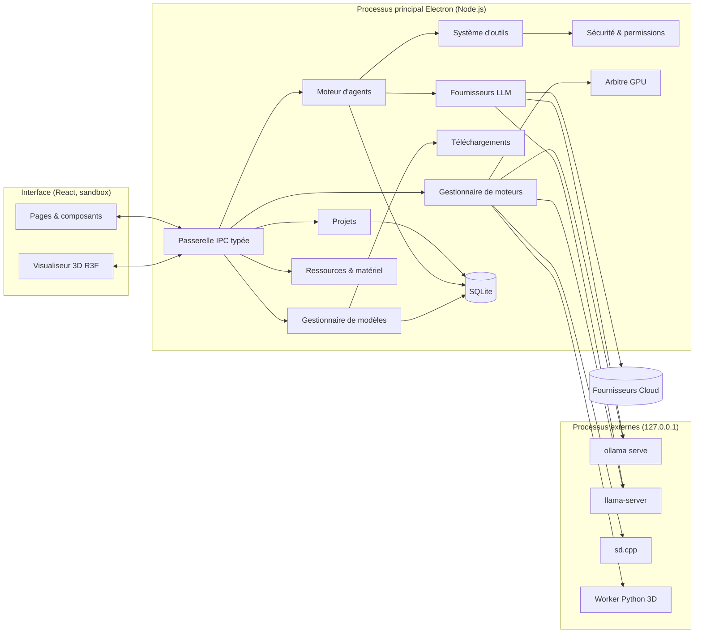

# AI STUDIO — Phase 2 : Architecture technique

*Version 1.0 — 3 novembre 2026. S'appuie sur `PHASE1_RECHERCHE_TECHNIQUE.md`.*

---

## 0. Principe : un logiciel pour tous les PC

AI STUDIO **ne vise aucune configuration particulière**. Tout ce qui dépend du matériel (moteur d'accélération, modèles proposés, taille de contexte, quantification, local ou Cloud) est **décidé au lancement, sur chaque PC**, par la détection matérielle et le recommandeur. Aucun réglage n'est codé pour une carte graphique précise. La matrice de compatibilité complète est en **section 18**.

Le tableau ci-dessous n'est qu'un **exemple de calcul** du recommandeur, sur l'une des machines de test (PC du porteur du projet). Il sert aussi de cas de test automatisé, au même titre que les autres profils de la section 18.

### Exemple : PC de test n°1 (milieu de gamme NVIDIA)

| Composant | Valeur | Conséquence |
|---|---|---|
| GPU | NVIDIA GeForce RTX 3060 Ti — **8 Go GDDR6**, ~448 Go/s, CUDA (Ampere, compute 8.6) | CUDA disponible pour LLM, images et 3D. VRAM utilisable ≈ **6,8 Go** |
| RAM | **32 Go DDR4** (~40–50 Go/s en double canal) | Mode hybride possible pour les modèles MoE de 20–30B |
| CPU | Intel Core i5-11400F — 6 cœurs / 12 threads, **AVX-512** | Binaire llama.cpp AVX-512 ; pas de GPU intégré (le « F ») → l'affichage Windows consomme de la VRAM sur la 3060 Ti |

C'est le **profil 2** du système de recommandation. Pack recommandé calculé (sert aussi de cas de test du moteur de recommandation) :

| Usage | Recommandation | Mode | Mémoire estimée | Vitesse estimée* |
|---|---|---|---|---|
| Discussion | Qwen3 8B Q4_K_M | **Rapide** (100 % GPU) | ~5,5 Go VRAM (contexte 8k) | ~40–60 tokens/s |
| Code / Agent | Qwen3-Coder 30B-A3B Q4_K_M (experts en RAM) | **Hybride** | ~5 Go VRAM + ~14 Go RAM | ~12–20 tokens/s |
| Alternative agent | gpt-oss-20b (MXFP4) | Hybride | ~5 Go VRAM + ~8 Go RAM | ~15–25 tokens/s |
| Vision | Qwen3-VL 8B ou Gemma 3 4B (Q4) | Rapide | ~4–6 Go VRAM | Rapide |
| Images | SDXL (fp16) / FLUX.1 schnell GGUF Q4 / Z-Image Turbo GGUF | Rapide (FLUX : encodeur de texte en RAM) | 6–7 Go VRAM | SDXL ~5–10 s/image ; FLUX schnell ~15–30 s |
| 3D rapide | TripoSR | Local | ~6 Go VRAM | Quelques secondes |
| 3D géométrie précise | TripoSG | Local **limite** (8 Go minimum annoncé = toute la VRAM) | 8 Go | À valider par test réel |
| 3D qualité | TRELLIS / TRELLIS.2 | **Cloud gratuit** (HF Spaces), 16–24 Go requis | — | ~1 min |

\* Estimations calculées (bande passante ÷ octets lus par token) ; remplacées par une mesure réelle après installation.

**Règle générale illustrée par cet exemple :** sur la majorité des PC grand public (4 à 12 Go de VRAM), on ne peut pas garder un LLM chargé pendant une génération d'image ou 3D. L'arbitre GPU (section 6) est donc un composant central pour tous les profils, pas un détail.

---

## 1. Vue d'ensemble



**Principes :**
1. L'interface n'a **aucun** accès direct au disque, au réseau ou aux processus : tout passe par l'IPC typé du processus principal.
2. Chaque moteur de calcul est un **processus séparé**, remplaçable, qui peut planter sans faire planter l'application.
3. Chaque fournisseur / moteur / outil implémente une **interface commune** : en ajouter un ne demande pas de modifier le reste.
4. Toute progression affichée provient d'un **événement réel** émis par un moteur ou un outil.

---

## 2. Choix technologiques

| Domaine | Choix | Justification |
|---|---|---|
| Application | **Electron** (dernière version stable au démarrage du dev) | Voir Phase 1, §7 |
| Langage | **TypeScript** strict partout (main, preload, renderer) | Un seul langage, types partagés |
| Interface | React 19 + Vite (via `electron-vite`) | Rapide, écosystème |
| Style | Tailwind CSS + composants maison sur **Radix UI** (accessibilité) | Design premium sans dépendre d'un kit visuel générique |
| Icônes | **Lucide** | Simples, cohérentes, pas d'emoji |
| Animations | **Motion** (ex-Framer Motion) | Transitions fluides de la timeline d'agent |
| État UI | Zustand + TanStack Query (sur IPC) | Léger, cache et invalidation |
| Panneaux redimensionnables | `react-resizable-panels` | |
| Éditeur / diff | **Monaco Editor** (diff côte à côte) | Avant / après des modifications de l'agent |
| Terminal | `node-pty` + **xterm.js** | Référence (VS Code) |
| 3D | **three.js + React Three Fiber + drei + three-mesh-bvh** | Sélection de faces rapide pour la segmentation |
| Base de données | **SQLite** via `better-sqlite3` + migrations | Local, fiable, sans serveur |
| Validation | **Zod** (IPC, fichiers JSON, réponses moteurs) | Aucune donnée non validée ne traverse une frontière |
| Matériel | `systeminformation` + `nvidia-smi` + module natif DXGI | Voir Phase 1, §2.4 |
| Git | `simple-git` (git du système) | |
| Recherche dans le code | **ripgrep** embarqué (`@vscode/ripgrep`) | Rapide, binaire officiel |
| Python (3D) | **uv** + Python autonome, environnements isolés par moteur | Installé à la demande, aucun Python système requis |
| Worker 3D | FastAPI + SSE | Événements de progression réels |
| Installateur | **electron-builder (NSIS)** | `.exe` d'installation, sans droits administrateur |
| Mises à jour | **electron-updater** + GitHub Releases | Gratuit |
| Build Windows | GitHub Actions (runner Windows, gratuit pour un dépôt public) ou `pnpm dist` sur le PC | |
| Tests | Vitest (unitaires), Playwright pour Electron (bout en bout) | |
| Monorepo | **pnpm workspaces** | |

---

## 3. Organisation du code

```
ai-studio/
├── apps/
│   └── desktop/
│       ├── src/main/                 # Processus principal
│       │   ├── index.ts              # Démarrage, fenêtre, cycle de vie
│       │   ├── ipc/                  # Routeur IPC typé (un fichier par domaine)
│       │   ├── services/             # Assemblage des modules (injection de dépendances)
│       │   └── windows/
│       ├── src/preload/index.ts      # contextBridge : API minimale et typée
│       └── src/renderer/             # Interface React
│           ├── app/                  # Routes, layout, barre latérale
│           ├── features/             # home, projects, assistant, images, 3d, library,
│           │                         # local-models, history, settings
│           ├── components/ui/        # Design system maison
│           └── styles/tokens.css     # Couleurs, espacements, typographie
├── packages/
│   ├── shared/        # Types, schémas Zod, contrats IPC, événements
│   ├── storage/       # SQLite, migrations, dépôts (repositories)
│   ├── projects/      # Gestionnaire de projets + accès fichiers sécurisé
│   ├── security/      # Permissions, politiques, journal d'audit
│   ├── providers/     # Adaptateurs LLM : ollama, llamacpp, lmstudio, openai-compatible
│   ├── agent/         # Boucle d'agent, planification, gestion du contexte
│   ├── tools/         # Registre d'outils + outils intégrés + client MCP
│   ├── engines/       # Gestion des processus : ollama, llama-server, sd.cpp, worker Python
│   ├── models/        # Catalogue, recommandation, installation
│   ├── downloads/     # Téléchargements reprenables, vérification
│   ├── hardware/      # Détection matériel, mesures en temps réel, arbitre GPU
│   ├── imaging/       # Orchestration génération d'images (local + cloud)
│   └── mesh3d/        # Orchestration 3D + segmentation (local + cloud)
├── workers/
│   └── python3d/      # Serveur FastAPI + un dossier par moteur (triposr, triposg, trellis, segmentation)
├── catalog/           # catalog.json, providers.json (versionnés, publiés séparément)
└── docs/
```

Règle de dépendance : `shared` ne dépend de rien ; les paquets métier ne dépendent que de `shared` et d'interfaces ; seul `apps/desktop/src/main/services` assemble les implémentations concrètes. Un moteur se remplace en changeant une ligne d'assemblage.

---

## 4. Contrats principaux (TypeScript)

### 4.1 Moteurs locaux

```ts
export type EngineId = 'ollama' | 'llamacpp' | 'sdcpp' | 'python3d' | string;

export interface EngineAdapter {
  id: EngineId;
  kind: 'llm' | 'image' | 'mesh3d' | 'segmentation';
  detect(): Promise<EngineInstallState>;           // installé ? version ? chemin ?
  install(opts: InstallOptions, onEvent: (e: ProgressEvent) => void): Promise<void>;
  start(): Promise<EndpointInfo>;                   // lance le processus, attend le health-check
  stop(): Promise<void>;
  health(): Promise<EngineHealth>;
  capabilities(): Promise<EngineCapabilities>;      // backends GPU disponibles, formats…
}
```

### 4.2 Fournisseurs LLM (local et Cloud derrière la même interface)

```ts
export interface LLMProvider {
  id: string;
  location: 'local' | 'cloud';                      // affiché partout, jamais déduit
  listModels(): Promise<ModelInfo[]>;
  verifyCapabilities(modelId: string): Promise<VerifiedCapabilities>; // test réel d'appel d'outil
  chat(req: ChatRequest, signal: AbortSignal): AsyncIterable<ChatStreamEvent>;
  quota?(): Promise<QuotaState>;                    // Cloud uniquement
}

export type ChatStreamEvent =
  | { type: 'text-delta'; text: string }
  | { type: 'reasoning-delta'; text: string }       // si le modèle expose son raisonnement
  | { type: 'tool-call'; id: string; name: string; args: unknown }
  | { type: 'usage'; inputTokens: number; outputTokens: number }
  | { type: 'rate-limit'; remaining?: number; resetAt?: string }
  | { type: 'done'; finishReason: 'stop' | 'tool-calls' | 'length' | 'error' };
```

Les fournisseurs Cloud sont décrits par configuration (`providers.json`), pas par du code :

```json
{
  "id": "groq",
  "label": "Groq",
  "location": "cloud",
  "badge": "GRATUIT",
  "baseUrl": "https://api.groq.com/openai/v1",
  "auth": "bearer",
  "signupUrl": "https://console.groq.com/keys",
  "modelsEndpoint": "/models",
  "freeFilter": { "type": "all" },
  "knownLimits": { "rpm": 30, "asOf": "2026-11-03" },
  "privacy": { "hosting": "US", "trainsOnData": false }
}
```

### 4.3 Images et 3D

```ts
export interface ImageEngine {
  id: string; location: 'local' | 'cloud';
  generate(job: ImageJob, signal: AbortSignal): AsyncIterable<JobEvent<ImageResult>>;
}
export interface Mesh3DEngine {
  id: string; location: 'local' | 'cloud';
  supports: { imageTo3D: boolean; multiImage: boolean; textured: boolean };
  generate(job: Mesh3DJob, signal: AbortSignal): AsyncIterable<JobEvent<MeshResult>>;
}
export interface SegmentationEngine {
  id: string; semanticLabels: boolean;               // vrai uniquement si le modèle nomme les parties
  segment(mesh: MeshRef, opts: SegmentOptions, signal: AbortSignal): AsyncIterable<JobEvent<PartMap>>;
}

export type JobEvent<T> =
  | { type: 'stage'; stage: string; label: string } // étape réelle (ex. "Suppression du fond")
  | { type: 'progress'; current: number; total: number } // ex. pas d'échantillonnage 12/25
  | { type: 'preview'; uri: string }
  | { type: 'log'; level: 'info' | 'warn'; message: string }
  | { type: 'result'; result: T }
  | { type: 'error'; message: string; recoverable: boolean };
```

### 4.4 Outils

```ts
export interface ToolDefinition<I, O> {
  name: string;                                     // ex. "fs.write_file"
  description: string;                              // envoyée au modèle
  input: z.ZodType<I>;                              // converti en JSON Schema pour le modèle
  risk: 'read' | 'write' | 'destructive' | 'exec' | 'network';
  run(input: I, ctx: ToolContext): Promise<ToolResult<O>>;
  preview?(input: I, ctx: ToolContext): Promise<ChangePreview>; // diff avant validation
}
```

---

## 5. IPC sécurisé

- `contextIsolation: true`, `sandbox: true`, `nodeIntegration: false` ; CSP stricte dans le renderer.
- Le preload expose **un seul objet** `window.aistudio` avec des méthodes typées générées depuis `packages/shared/ipc.ts`.
- Requête/réponse : `ipcRenderer.invoke` ; flux (tokens, événements d'agent, progression) : `MessagePort` dédiés par tâche.
- Chaque entrée IPC est validée par Zod dans le processus principal.
- Les moteurs écoutent uniquement sur `127.0.0.1`, sur des ports libres choisis au démarrage. Le worker Python exige un **jeton interne aléatoire** généré à chaque lancement, pour qu'un autre programme du PC ne puisse pas l'utiliser. Ce jeton est interne et invisible : ce n'est pas une API Key et l'utilisateur ne le voit jamais.

---

## 6. Arbitre GPU (essentiel avec 8 Go)

Un seul gestionnaire décide qui occupe la VRAM.

1. Chaque tâche déclare son besoin estimé (`vramNeededMB`) et sa priorité (interactive > arrière-plan).
2. Si la VRAM libre mesurée ne suffit pas, l'arbitre **décharge** les occupants inactifs dans l'ordre : modèle LLM inactif (`keep_alive: 0` via l'API Ollama) → pipeline image → worker 3D.
3. Si un occupant est **actif** (un agent est en train de répondre), la nouvelle tâche est **mise en file d'attente** avec un message clair : « En attente : le modèle Qwen3 8B génère une réponse. »
4. L'utilisateur peut forcer : « Arrêter l'agent et lancer la génération ».
5. Mesure réelle de la VRAM via `nvidia-smi` (toutes les 2 s pendant l'activité), affichée dans la barre d'état.

---

## 7. Stockage

### 7.1 Emplacements

```
%APPDATA%\AI Studio\           (configurable dans Paramètres > Emplacement des données)
├── aistudio.db                SQLite
├── engines\                   ollama\, llamacpp\, sdcpp\, python\ (uv + environnements)
├── models\                    ollama\ (OLLAMA_MODELS), gguf\, image\, 3d\
├── generations\<projectId>\   images et modèles 3D générés
├── snapshots\<projectId>\     copies de sauvegarde avant modification par l'agent
└── logs\
```

Les fichiers de l'utilisateur **restent dans son dossier de projet** : AI STUDIO n'y écrit rien d'autre que ce que l'agent a été autorisé à écrire (pas de dossier caché imposé).

### 7.2 Schéma SQLite (tables principales)

| Table | Contenu |
|---|---|
| `projects` | id, nom, description, chemin du dossier, modèle par défaut, paramètres (JSON), dates |
| `project_permissions` | id projet, portée (dossiers autorisés), niveau par type de risque (auto / demander / interdit) |
| `conversations` / `messages` | Fils de discussion, rôle, contenu, fournisseur et modèle **réellement** utilisés, tokens |
| `agent_runs` | Exécution d'agent : objectif, statut, début/fin, modèle |
| `agent_events` | Timeline : type, outil, fichier, entrée, résultat, statut, horodatage (source de vérité de l'affichage) |
| `file_changes` | Changements proposés/appliqués : chemin, snapshot avant, contenu après, statut (proposé / accepté / refusé / annulé) |
| `generations` | Images et 3D : type, moteur, local/cloud, paramètres, graine, fichiers produits |
| `mesh_parts` | Parties segmentées : génération, nom, indices de faces, visibilité |
| `installed_models` | Modèles réellement présents sur disque (vérifiés au démarrage) |
| `downloads` | File de téléchargements, octets reçus, statut |
| `provider_accounts` | Fournisseurs Cloud configurés (clé chiffrée par `safeStorage`), compteur de quota |
| `audit_log` | Toute action sensible : commande exécutée, suppression, accès refusé |
| `settings` | Clé / valeur |

**Règle :** le statut « installé » d'un modèle est **recalculé** au démarrage à partir du disque et du moteur (`/api/tags` d'Ollama), jamais simplement lu en base.

---

## 8. Gestionnaire de projets et accès aux fichiers

- Création : nom, description, **sélection d'un dossier existant** (boîte de dialogue native) ou création d'un nouveau.
- Toute opération de fichier passe par `ProjectFS`, qui :
  1. résout le chemin réel (`fs.realpath`) et **refuse tout ce qui sort du dossier autorisé** (y compris par lien symbolique ou `..`) ;
  2. applique une liste d'exclusion configurable (`.git/`, `node_modules/`, `.env`, clés, gros binaires) ;
  3. respecte `.gitignore` pour l'exploration et la recherche.
- Écriture : l'agent produit une **proposition de changement** → diff Monaco avant/après → l'utilisateur accepte, refuse ou modifie. Mode « auto-accepter » possible par projet, avec snapshot systématique.
- Annulation : chaque changement appliqué peut être annulé à partir du snapshot (même sans Git).
- Suppression : toujours confirmée ; le fichier part dans la **Corbeille Windows** (`shell.trashItem`), pas en suppression définitive.
- Surveillance du dossier (`chokidar`) pour refléter les modifications externes.

---

## 9. Moteur d'agents

### 9.1 Boucle

```
objectif utilisateur
  → construction du contexte (instructions système, carte du projet, fichiers ouverts, historique résumé)
  → appel du modèle (flux)
  → si appels d'outils : contrôle des permissions → (validation utilisateur si nécessaire) → exécution → résultat renvoyé au modèle
  → répéter jusqu'à réponse finale, arrêt par l'utilisateur ou limite d'itérations
```

### 9.2 Visualisation fidèle (aucune progression inventée)

Les 9 étapes du cahier des charges sont **dérivées des événements réels**, pas d'un minuteur :

| Étape affichée | Déclenchée par |
|---|---|
| Analyse de la demande | début du run, avant la première réponse du modèle |
| Réflexion et planification | flux `reasoning-delta` ou outil `plan.update` |
| Exploration du projet | outils `fs.list`, `fs.glob`, `project.map` |
| Lecture des fichiers | `fs.read` |
| Sélection des outils | réception d'un `tool-call` |
| Exécution des actions | `shell.run`, `git.*`, `web.*`, `image.*`, `mesh3d.*` |
| Création / modification | `fs.write`, `fs.edit`, `fs.move` |
| Vérification | `shell.run` marqué test/build, `code.diagnostics` |
| Finalisation | réponse finale sans appel d'outil |

Une étape non rencontrée reste « en attente » ou est masquée : elle n'est jamais cochée artificiellement. Chaque événement de la timeline montre l'outil, l'objectif (texte fourni par le modèle dans l'appel), le fichier, le résultat (repliable) et le statut.

### 9.3 Adapté aux petits modèles locaux

- **Profils d'outils** : un modèle 8B reçoit un jeu réduit d'outils (lecture, écriture, recherche, terminal) avec des descriptions courtes ; un modèle plus capable reçoit le jeu complet.
- **Carte du projet** compacte (arborescence + symboles principaux) au lieu de fichiers entiers.
- **Gestion du contexte** : résumé automatique des anciens échanges quand on approche de la limite.
- **Réparation des appels d'outils** : si le JSON d'un appel est invalide, le message d'erreur Zod est renvoyé au modèle (2 tentatives maximum), puis échec visible.
- Le mode Agent n'est proposé que pour les modèles dont la capacité outils a été **vérifiée** (Phase 1, §2.3).

### 9.4 Arrêt immédiat

Bouton « Arrêter » toujours visible : `AbortController` sur l'appel modèle + arrêt de l'**arbre de processus** des commandes en cours (`taskkill /T /F`) + annulation des téléchargements de l'agent. Les changements déjà appliqués restent annulables.

---

## 10. Système d'outils (v1)

| Outil | Risque | Par défaut |
|---|---|---|
| `fs.list`, `fs.glob`, `fs.read`, `search.code` (ripgrep), `project.map` | read | Automatique |
| `fs.write`, `fs.edit` (remplacement ciblé), `fs.mkdir` | write | **Diff à valider** |
| `fs.move`, `fs.rename` | write | Confirmation |
| `fs.delete` | destructive | Confirmation obligatoire (Corbeille) |
| `shell.run` (terminal intégré, dossier du projet) | exec | Confirmation ; liste blanche optionnelle (`npm test`, `git status`…) ; liste noire stricte (formatage, `rm -rf /`, modification du registre…) |
| `git.status`, `git.diff`, `git.log` | read | Automatique |
| `git.commit`, `git.checkout` | write | Confirmation |
| `web.search`, `web.fetch` | network | Confirmation par domaine (désactivé en mode hors ligne) |
| `image.generate`, `image.analyze` | write | Automatique (dans le projet) |
| `mesh3d.generate`, `mesh3d.segment`, `mesh3d.export` | write | Automatique |
| `plan.update` | — | Automatique (met à jour le plan affiché) |
| Outils **MCP** externes | selon déclaration | Confirmation au premier usage |

Ajouter un outil = un fichier qui exporte un `ToolDefinition`, enregistré dans le registre. Les serveurs **MCP** (Model Context Protocol) permettent d'ajouter des outils tiers sans modifier AI STUDIO.

**Isolation** : les commandes s'exécutent dans le dossier du projet, avec un environnement filtré (pas de variables contenant des clés) et un délai maximal. Une isolation plus forte (Windows Sandbox / conteneur) est prévue en option ultérieure : non promise en v1.

---

## 11. Gestionnaire de modèles et téléchargements

- **Catalogue** : `catalog.json` (Phase 1, §2.4-h) fusionné avec ce que les moteurs rapportent réellement.
- **Recommandation** : module `models/recommender.ts`, fonction pure `recommend(hardware, catalog) → Recommendation[]`, testée sur des profils matériels fixes (dont le PC de référence ci-dessus).
- **Téléchargements** :
  - Ollama : `POST /api/pull` en flux → progression réelle (octets / total) par couche ;
  - GGUF et poids image / 3D : HTTP avec reprise (`Range`), plusieurs fichiers en parallèle limités, **vérification SHA-256** fournie par le Hub, écriture dans un fichier `.part` puis renommage ;
  - vérification de l'espace disque **avant** le démarrage ;
  - pause / reprise / annulation, reprise automatique après redémarrage de l'application.
- **Suppression** : via le moteur (`DELETE /api/delete` pour Ollama) ou suppression des fichiers, puis recalcul de l'état.
- **Mises à jour de modèles** : comparaison du condensé (digest) local et distant, bouton « Mettre à jour ».

---

## 12. Génération d'images

- Moteur : **stable-diffusion.cpp** (binaire CUDA pour NVIDIA, Vulkan pour AMD/Intel, CPU sinon), téléchargé dans `engines/sdcpp/`.
- Exécution par tâche ; la progression (pas d'échantillonnage n/N) est **lue sur la sortie réelle** du programme ; prévisualisation de l'image finale.
- Fonctions v1 : texte → image, image → image (référence + force), variantes (graines), résolution, étapes, CFG, échantillonneur, négatif, LoRA (SDXL), historique par projet.
- Inpainting : via le connecteur **ComfyUI** optionnel (affiché « nécessite ComfyUI » tant qu'il n'est pas installé).
- Cloud : Cloudflare Workers AI et HF Spaces derrière la même interface `ImageEngine`.

---

## 13. Génération 3D et segmentation

### 13.1 Worker Python

- Installé **uniquement** quand l'utilisateur active la 3D : `uv` télécharge un Python autonome, puis crée **un environnement par moteur** (TripoSR, TripoSG, TRELLIS et segmentation ont des dépendances incompatibles entre elles).
- Taille annoncée avant installation (PyTorch CUDA ≈ 3–5 Go par environnement, poids des modèles en plus).
- Serveur FastAPI unique qui charge à la demande le moteur demandé ; événements SSE (`stage`, `progress`, `result`).
- Prétraitement commun : suppression de fond (rembg / BiRefNet, licences libres), recentrage.
- Post-traitement commun avec `trimesh` : réduction de polygones, export GLB / OBJ / PLY / STL ; FBX via Blender en ligne de commande si présent.

### 13.2 Cloud 3D

Client Gradio vers les Spaces publics (TRELLIS, TRELLIS.2, TripoSG) : file d'attente, quota ZeroGPU affiché (2 min/jour anonyme, 5 min/jour avec compte HF gratuit), contrôle de disponibilité avant de proposer le bouton.

### 13.3 Segmentation (niveaux de la Phase 1, §6.2)

| Niveau | Implémentation | Où |
|---|---|---|
| 1. Composantes connexes | `trimesh.split` | Worker Python (rapide, CPU) |
| 2. Sélection manuelle | Pinceau / lasso / remplissage par angle dièdre, `three-mesh-bvh` | Interface (aucun calcul externe) |
| 3. IA libre (SAM 2 multi-vues) | Rendu de N vues → SAM 2 → projection et vote sur les faces → nettoyage par graphe d'adjacence | Worker Python, GPU |
| 4. PartField | Optionnel, badge « non commercial » | Worker Python, GPU |

Les parties sont stockées comme **listes d'indices de faces** (`mesh_parts`) : masquer, supprimer, renommer, exporter une partie seule ou « toutes les parties en fichiers séparés ».

---

## 14. Ressources et matériel

- Instantané au démarrage (Phase 1, §2.4-a) + mesures en direct : CPU, RAM, VRAM (`nvidia-smi`), disque, téléchargements actifs.
- Barre d'état discrète : moteur actif, modèle chargé, VRAM utilisée.
- Page Paramètres > Ressources : graphiques des 5 dernières minutes.

---

## 15. Mises à jour

- Application : electron-updater + GitHub Releases (notification, téléchargement en arrière-plan, installation au redémarrage).
- Catalogue et fournisseurs : fichiers JSON publiés séparément, mis à jour **sans** republier l'application.
- Moteurs (Ollama, llama.cpp, sd.cpp) : versions épinglées et testées, mise à jour proposée dans Paramètres.

---

## 16. Stratégie de tests

| Niveau | Contenu |
|---|---|
| Unitaires (Vitest) | Recommandeur (profils fixes dont la 3060 Ti), estimation mémoire, `ProjectFS` (évasion de chemin, liens symboliques), politique de permissions, parseurs de progression, schémas Zod |
| Contrats | Chaque `LLMProvider` passe la même suite (flux, appel d'outil, annulation, erreur 429) contre un serveur simulé, **et** contre le vrai moteur en test d'intégration |
| Intégration | Ollama réel avec un petit modèle : installation → lancement → chat → appel d'outil → arrêt |
| **Hors ligne** | Test avec réseau coupé : un modèle local déjà installé doit fonctionner sans API Key, sans compte, sans requête externe (vérifié en interceptant toute connexion sortante) |
| Bout en bout (Playwright) | Création de projet, agent qui modifie un fichier avec validation du diff, génération d'image, chargement d'un GLB dans le visualiseur |
| Performance | Visualiseur avec un maillage de 1 M de triangles sans bloquer l'interface |

---

## 17. Plan de développement (Phases 3 et 4)

| Jalon | Contenu | Livrable testable |
|---|---|---|
| **M1 — Socle** | Monorepo, Electron sécurisé, design system, barre latérale, 9 pages (pages non terminées marquées « En développement »), SQLite, paramètres, détection matériel | `.exe` qui s'installe et s'ouvre |
| **M2 — IA locale** | Moteur Ollama embarqué, catalogue, recommandation, téléchargements, assistant de discussion en flux | Discuter avec Qwen3 8B hors ligne, sans clé |
| **M3 — Cloud** | Adaptateur compatible OpenAI, `providers.json`, assistant d'inscription, quotas, sélecteur de modèles | Discuter via Groq / Gemini / OVHcloud (sans clé) |
| **M4 — Projets & agents** | `ProjectFS`, outils, permissions, diff, timeline réelle, terminal, arrêt | L'agent crée et modifie des fichiers dans un dossier choisi |
| **M5 — Images** | sd.cpp, interface de génération, historique, Cloud images | SDXL / FLUX schnell en local |
| **M6 — 3D** | Worker Python, TripoSR / TripoSG, Cloud TRELLIS, visualiseur complet, exports | Image → GLB affiché et exporté |
| **M7 — Segmentation** | Niveaux 1 et 2, puis 3 (SAM 2) | Découper, masquer et exporter des parties |
| **M8 — Finition** | Historique global, notifications, mises à jour automatiques, documentation, tests complets | Version 1.0 |

Chaque jalon produit un `.exe` installable, testé sur la matrice de la section 18.

---

## 18. Compatibilité multi-PC

### 18.1 Configuration minimale de l'application elle-même

| Élément | Minimum | Remarque |
|---|---|---|
| Système | Windows 10 64 bits (22H2) ou Windows 11 | Windows 11 **ARM** (Snapdragon) : build ARM64 prévue, moteurs à valider (voir 18.3) |
| CPU | x64 avec AVX2 (quasi tous les CPU depuis 2015) ; AVX simple en mode dégradé | Le bon binaire llama.cpp / sd.cpp (AVX, AVX2, AVX-512) est choisi automatiquement |
| RAM | 8 Go | En dessous : interface et Cloud uniquement, local déconseillé avec explication |
| Disque | 2 Go pour l'application + moteurs ; espace des modèles en plus | Le dossier des modèles peut être placé sur n'importe quel disque |
| GPU | **Aucun obligatoire** | Tout fonctionne en CPU ou en Cloud, plus lentement |

Sans GPU, sans Internet après installation, sans compte : discussion locale avec un petit modèle **garantie** (c'est le test de base de la section 16).

### 18.2 Matrice par type de PC

| Type de PC | Accélération choisie | Discussion / code locaux | Images locales | 3D locale | 3D proposée |
|---|---|---|---|---|---|
| **NVIDIA récente** (RTX 20/30/40/50, ≥ 6 Go) | CUDA | Oui, taille selon VRAM | Oui | Oui selon VRAM (TripoSR 6 Go, TRELLIS 16 Go…) | Local, sinon Cloud |
| **NVIDIA ancienne** (GTX 10xx/16xx, 4–6 Go) | CUDA si compute capability supportée par le moteur, sinon Vulkan | Petits modèles, hybride | SD 1.5 / SDXL quantifié | TripoSR si ≥ 6 Go | Cloud |
| **AMD Radeon** (RX 6000/7000/9000) | ROCm si la carte est supportée sous Windows, sinon **Vulkan** | Oui | Oui (Vulkan) | **Non** (générateurs CUDA uniquement) | **Cloud gratuit** |
| **AMD ancienne** (RX 5000 et avant) | Vulkan | Oui | Oui, plus lent | Non | Cloud |
| **Intel Arc** (A/B series) | Vulkan (SYCL en option) | Oui | Oui (Vulkan) | Non | Cloud |
| **GPU intégré** (Intel Iris/UHD, AMD Radeon intégré) | CPU, ou Vulkan si plus rapide (mesuré) | Petits modèles (≤ 4B) | Lent (SD-Turbo / Cloud conseillé) | Non | Cloud |
| **Sans GPU** (CPU seul) | CPU | Petits modèles (≤ 4B, MoE si beaucoup de RAM) | Très lent → Cloud conseillé | Non | Cloud |
| **Portable sur batterie** | Comme ci-dessus | Avertissement consommation ; profil « économie » proposé | Idem | Idem | Idem |
| **Plusieurs GPU** | Le GPU le plus capable par défaut, choix manuel possible | Répartition multi-GPU (llama.cpp) en option | Un GPU | Un GPU | — |
| **Windows ARM (Snapdragon X)** | CPU (NPU non exploité en v1) | Petits modèles | Cloud | Non | Cloud |

Le recommandeur ne propose **jamais** un modèle classé « Trop lourd » en premier ; le Cloud gratuit est suggéré automatiquement là où le local est impossible ou trop lent, avec le badge CLOUD.

### 18.3 Points à valider avant de promettre (pas encore vérifiés)

- Liste exacte des GPU AMD supportés par ROCm sous Windows dans la version d'Ollama embarquée ; sinon Vulkan.
- Compute capability CUDA minimale de la version d'Ollama / llama.cpp embarquée (les plus anciennes GTX peuvent nécessiter Vulkan).
- Disponibilité des binaires ARM64 Windows d'Ollama, llama.cpp et stable-diffusion.cpp au moment du développement.
- Comportement de la VRAM partagée des GPU intégrés (la mémoire « dédiée » rapportée est souvent minuscule : la RAM système est alors utilisée comme budget).

### 18.4 Robustesse

- **Repli automatique** : si le backend choisi échoue au premier lancement (pilote trop ancien, crash), AI STUDIO réessaie avec le suivant (CUDA → Vulkan → CPU) et l'indique clairement, avec un lien pour mettre à jour le pilote.
- **Pilotes** : version détectée ; si trop ancienne pour CUDA / Vulkan, message précis et lien vers la page officielle du fabricant.
- **Antivirus / SmartScreen** : les moteurs sont des exécutables téléchargés ; ils sont vérifiés par SHA-256 et lancés depuis le dossier de l'application. L'installateur non signé déclenchera un avertissement SmartScreen (une signature de code est payante : limitation documentée).
- **Chemins Windows** : support des noms d'utilisateur avec espaces et accents, chemins longs, dossiers OneDrive.
- **Langues / mises en page** : interface en français et en anglais dès la v1, textes externalisés.

### 18.5 Comment on teste sur des PC qu'on n'a pas

| Méthode | Ce qu'elle couvre |
|---|---|
| **Profils matériels simulés** (fichiers JSON : sans GPU 8 Go, iGPU 16 Go, GTX 1060 6 Go, RTX 3060 Ti 8 Go, RX 6700 XT 12 Go, Arc A770 16 Go, RTX 4090 24 Go, portable sur batterie, Windows ARM…) | Le recommandeur, l'estimation mémoire et les choix de backend sont testés automatiquement sur chaque profil |
| **Intégration continue Windows** (runners GitHub sans GPU) | Installation, démarrage, chat local **en CPU**, test hors ligne, à chaque version |
| **PC de test réels** (porteur du projet + volontaires) | CUDA, Vulkan, AMD, performances réelles |
| **Rapport de diagnostic intégré** (Paramètres > Ressources > « Copier le diagnostic ») | Matériel, pilotes, backend choisi, erreurs : sans aucune donnée personnelle, envoyé uniquement si l'utilisateur le copie lui-même |
| **Mesures réelles locales** | Après chaque installation de modèle, la vitesse mesurée remplace l'estimation et affine les recommandations sur ce PC |
